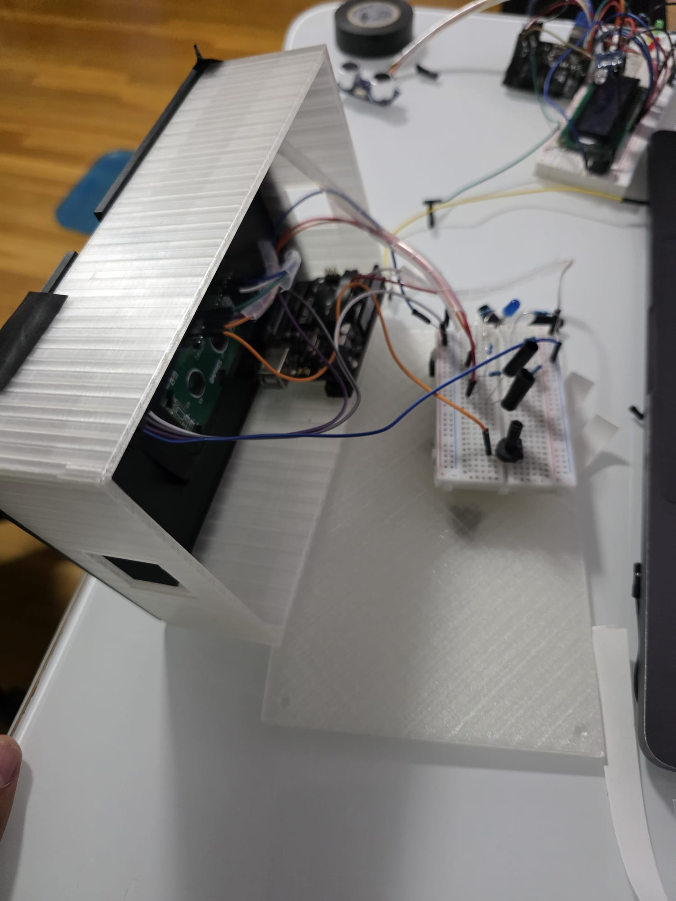
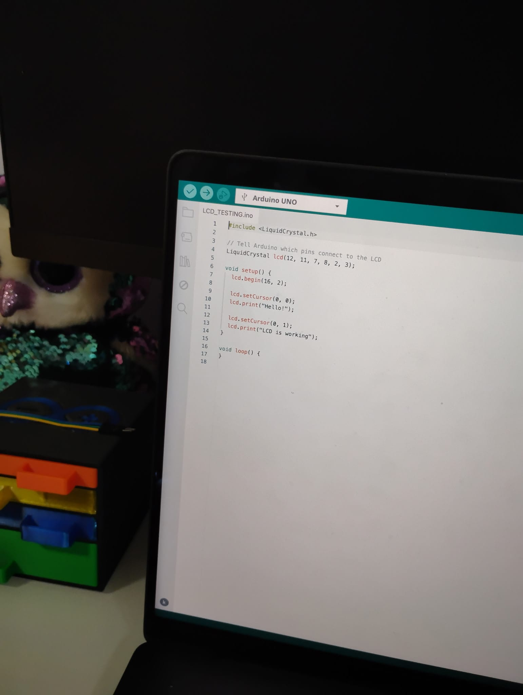
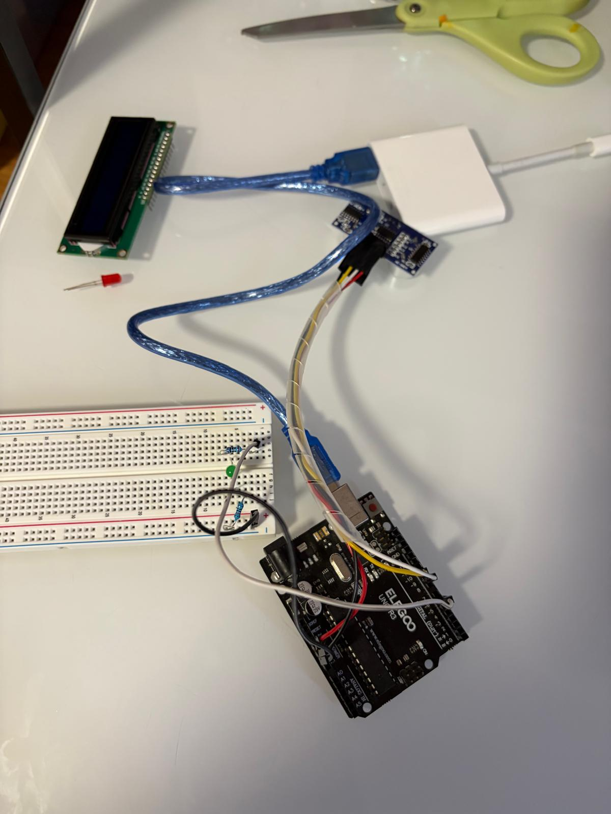
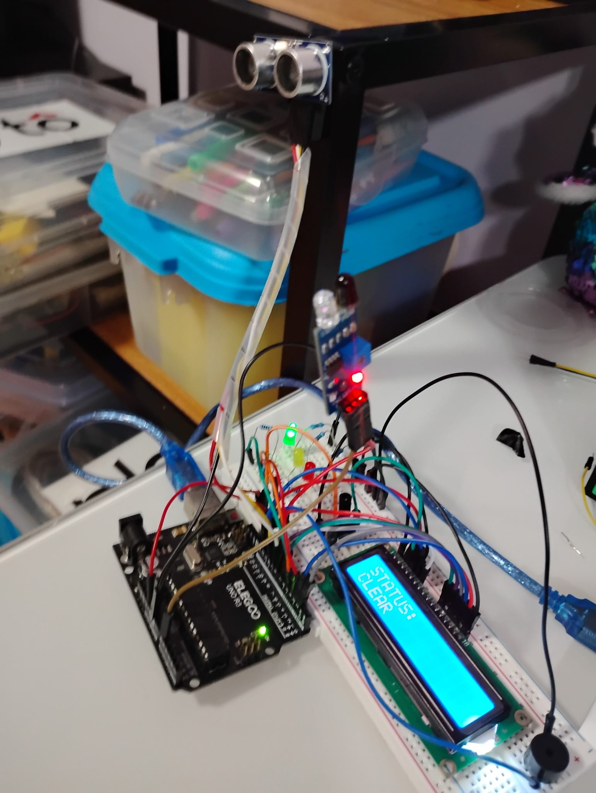
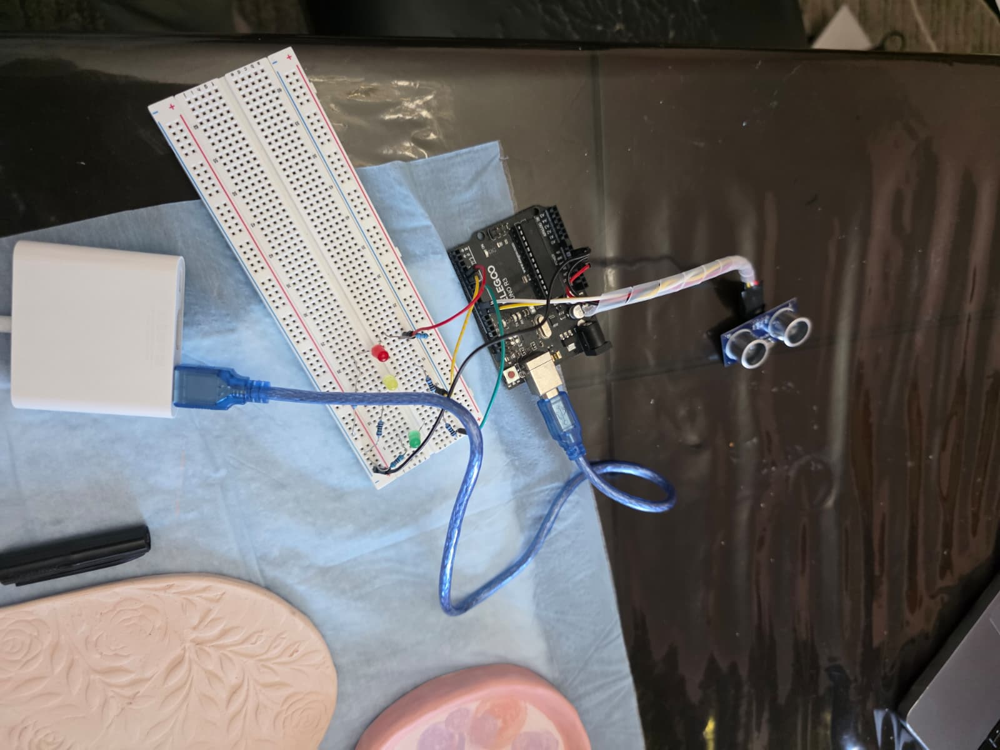
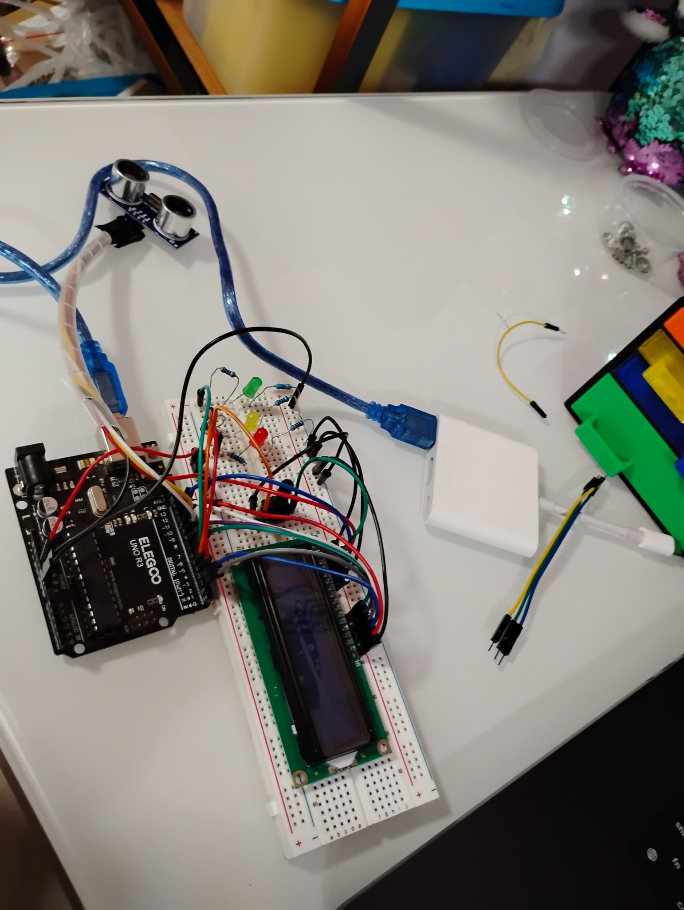

# HACKCLUB_WARMUPPROJECT

This is the first-ever hardware project that I will be making! I am using an Arduino Uno R3, some LEDs, a Breadboard, resistors, and an ultrasonic sensor. I am making a sensor detection system that can be implemented in real life for sidewalks where there are traffic lights. The traffic lights will be red, yellow, or green according to the ultrasonic sensor. If the ultra sonic sensor detects something coming towards the crosswalk(human) that is 21 cm or more away(for this model), it will turn the traffic light yellow. 
This is the traffic LIght project for the warm up 

Adding Hardware in 3D model First image 

For this image I was doing a test for the LCD dispaly to dispaly text based on the color of the LEDS!

In this image, I am coding on Arduino IDE for the LCD to dispaly a smaple text of "LCD is Working"!

Here are the steps that I took to create this project: 

0: Before: 

I researched about 30 minutes about what project I wanted to make. Then the idea of a trafic light system came in my mind(heres why: Whenever I walk to get to places(like home) I sometimes feel a little uncomfortable walking across cross walks in traffic light areas). I thought of making a project that ensured that whenever walkers got close by, the light would become yellow to allow drivers to slow down, and prepare for an red light. Then the red light occurs to stop drivers. If both cross walks turn the light into red, then both cross walks will be open to people walking!

1: First: 

I started by connecting the ultrasonic sensor to my Arduino Uno. I connected the GND, and 5V pin to the breadboard pins, and then connected the other two pins to put values to serial monitor. I tested the sensor by moving my hand closer and farther away while observing the distance measurements in the Serial Monitor.

Second: 

After successfully testing the ultrasonic sensor, I connected three LEDs to my breadboard. I programmed the green LED to turn on when an object was far away, the yellow LED when an object was getting closer, and the red LED when an object was very close. I did the code after connections btw. 

Third : Adding the LCD Display + Buzzer 

Next, I connected a 16×2 LCD display and a potentiometer(to turn on, off/transperceny)I added a buzzer to make the warning system more noticeable.

Step 5: Adding the IR Sensor
I wanted to improve my project by adding another method of obstacle detection.I connected an IR sensor and tested it separately using the Serial Monitor. Once I confirmed that it detected objects correctly, I integrated it into my main Arduino program.

I started my coding on Arduino UNo, and it took me a long time verifying everything, and making sure the code works. (took me soooo long)

Challenges I Faced: 

-- One challenge I faced was connecting the LCD display correctly because it required several wires and specific Arduino pins.

---I also had to make sure the different components were using the correct pins so that they would not interfere with one another.

I addressed these challenges by testing components individually before integrating them.

Updates, I would like to do:

1. Design a PCB desing, since i learned how to through half life week 1!
2. Add more ir sensors for accurate values 

Here are all the remaining pictures + STEP files!

3D Model Files:

[Download the STEP file for Body Part](3D-Model/myfile.step)

Notes: There is no BOM for this Project, I cancelled it last minute.

Anyways, thanks for reading through my readme!

